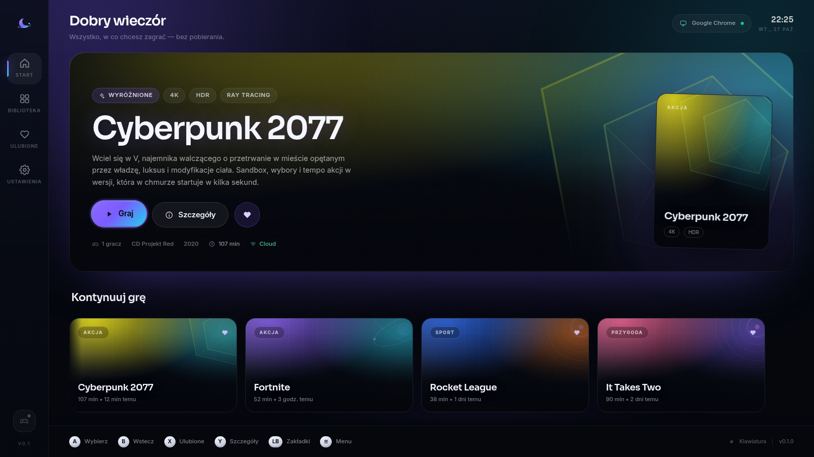
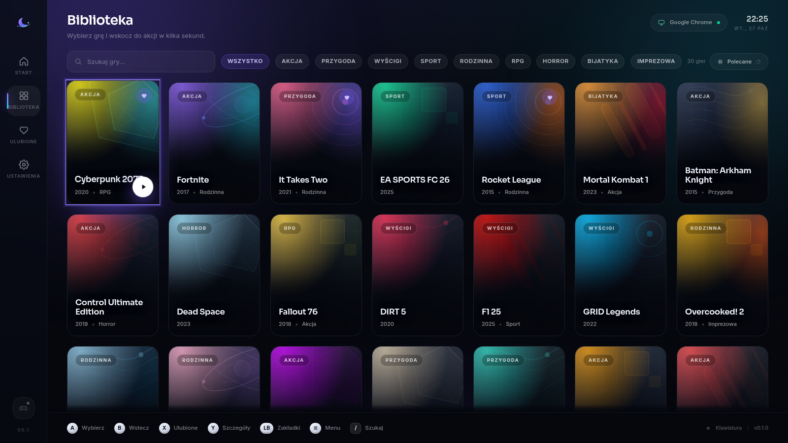
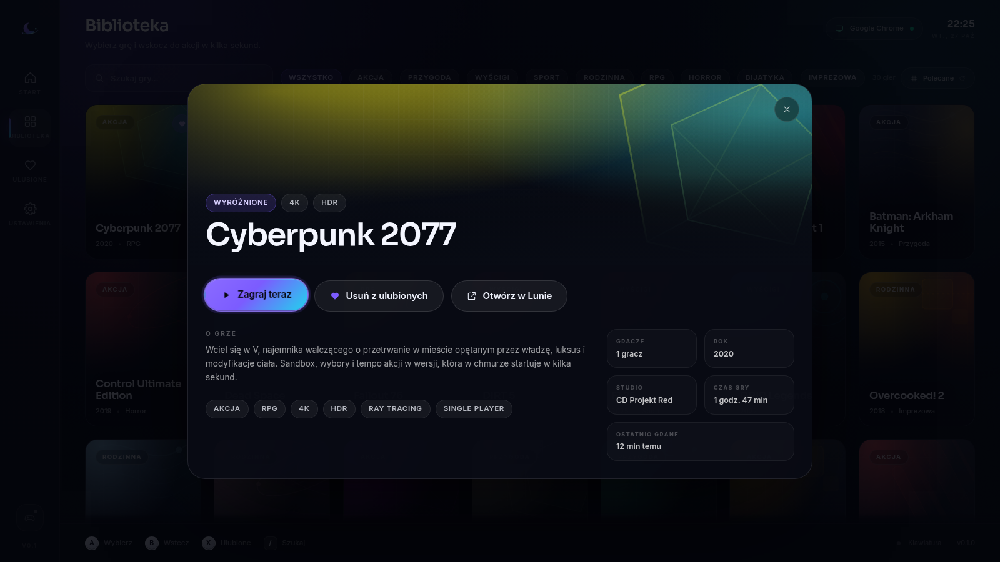
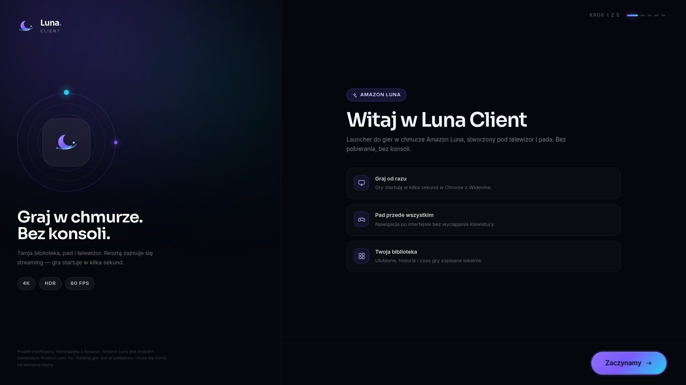
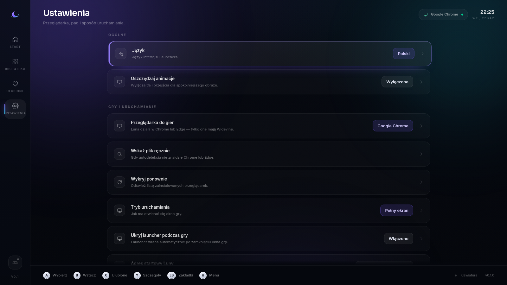

# Luna Client

Nieoficjalny launcher desktopowy do **Amazon Luna** — z interfejsem zaprojektowanym pod telewizor i pada, biblioteką gier, ulubionymi i pomiarem czasu gry.

Tauri 2 (Rust) odpowiada za warstwę systemową i wejście, React 19 za interfejs, a sama sesja gry działa w osobnym oknie Chrome/Edge z pełnym wsparciem **Widevine DRM**. Dzięki temu logowanie Amazon, 2FA i streaming działają jak w normalnej przeglądarce.



## Spis treści

- [Dlaczego osobne okno przeglądarki](#dlaczego-osobne-okno-przeglądarki)
- [Funkcje](#funkcje)
- [Wymagania](#wymagania)
- [Szybki start](#szybki-start)
- [Tryb podglądu (bez Tauri)](#tryb-podglądu-bez-tauri)
- [Sterowanie](#sterowanie)
- [Jak to działa](#jak-to-działa)
- [Dane aplikacji](#dane-aplikacji)
- [Budowanie paczek](#budowanie-paczek)
- [Struktura projektu](#struktura-projektu)
- [Rozwiązywanie problemów](#rozwiązywanie-problemów)
- [Ograniczenia i roadmapa](#ograniczenia-i-roadmapa)
- [Licencja i zastrzeżenia](#licencja-i-zastrzeżenia)

## Dlaczego osobne okno przeglądarki

Amazon Luna wymaga DRM Widevine. WebView Tauri (WebKitGTK na Linuksie, WebView2 na Windows, WKWebView na macOS) **nie dostarcza tego CDM-a**, więc osadzenie streamingu w oknie aplikacji kończy się błędem odtwarzania. Launcher jest więc „mózgiem”: pokazuje bibliotekę i steruje sesją, a obraz gry trafia do dedykowanego profilu Chrome/Edge uruchamianego w trybie `--app` (lub `--kiosk`).

Zalety takiego układu:

- działający Widevine, logowanie Amazon i 2FA,
- pad obsługiwany natywnie przez przeglądarkę, bez dodatkowej latencji,
- profil gracza z zapamiętanym logowaniem (`~/.local/share/pl.lunaclient.app/player`),
- launcher nie ingeruje w strumień gry i nie łamie zabezpieczeń DRM.

## Funkcje

- **Kinowy interfejs 10-foot UI** — ciemne glass panele, proceduralne okładki, animowane tło, płynne przejścia.
- **Pełna obsługa pada** — odczyt przez `gilrs` w Rust (hot-plug, bateria), nawigacja przestrzenna po całym UI.
- **Biblioteka i ulubione** — 30 gier w kuratorowanym katalogu + własne wpisy po URL.
- **Historia i czas gry** — zapis lokalny, sekcja „Kontynuuj grę”, ostatnio grane.
- **Onboarding** — wybór przeglądarki, diagnostyka Widevine, instrukcja parowania pada, język i tryb ekranu.
- **Tryby uruchamiania** — okno, pełny ekran lub kiosk TV.
- **PL / EN** — pełne tłumaczenie interfejsu.
- **Offline-first** — UI, katalog i ustawienia działają bez sieci; sieć potrzebna jest tylko do Luny.
- **Bez telemetrii** — żadnych danych poza urządzenie.

| Biblioteka | Szczegóły |
| --- | --- |
|  |  |

| Onboarding | Ustawienia |
| --- | --- |
|  |  |

## Wymagania

### Linux (główna platforma)

- Debian 13 / Ubuntu 24.04 lub nowszy, X11 albo Wayland
- **Google Chrome** (zalecany) albo Microsoft Edge — Widevine jest wymagany do streamingu
- Rust 1.77+ (`rustup`), Node.js 20.19+
- Pakiety systemowe:

```bash
sudo apt update
sudo apt install -y build-essential curl file libssl-dev pkg-config \
  libwebkit2gtk-4.1-dev libgtk-3-dev libayatana-appindicator3-dev \
  librsvg2-dev libudev-dev
```

`libudev-dev` jest potrzebny do budowy `gilrs` (obsługa pada). `libayatana-appindicator3-dev` przydaje się, jeśli w przyszłości dodasz tray icon.

### Windows

- Windows 10/11, WebView2 Runtime (jest w systemie), Rust + Node.js
- Do grania: Chrome lub Edge (Edge jest domyślnie zainstalowany)

### macOS

- macOS 12+, Xcode Command Line Tools, Rust + Node.js
- Do grania: Chrome (najlepiej) lub Safari

> Projekt jest rozwijany przede wszystkim pod Linuksa (mini PC / TV / Steam Deck). Windows i macOS są wspierane w kodzie, ale dopracowanie pakowania jest w roadmapie.

## Szybki start

```bash
git clone <twoje-repo> lunaclient
cd lunaclient
npm install
npm run tauri dev
```

Pierwsze uruchomienie otworzy kreator: wybierz przeglądarkę, sprawdź Widevine, podłącz pad i gotowe.

### Build produkcyjny

```bash
npm run tauri build
```

Artefakty trafiają do `src-tauri/target/release/bundle/` (`deb`, `AppImage`, a na Windows `nsis`).

## Tryb podglądu bez Tauri

Sam interfejs można rozwijać w zwykłej przeglądarce — backend jest wtedy mockowany (`src/lib/bridge.ts`), a uruchamianie gry symulowane:

```bash
npm run dev
# http://localhost:1420/?demo=1   – wypełniona biblioteka, historia i ulubione
# http://localhost:1420/?reset=1  – czysty profil, kreator od zera
```

Przyciski i pad działają w podglądzie tak samo jak w aplikacji (fallback na Gamepad API przeglądarki). Tryb podglądu oznacza interfejs plakietką „Tryb podglądu”.

## Sterowanie

| Akcja | Pad | Klawiatura |
| --- | --- | --- |
| Nawigacja | D-pad / lewy drążek | Strzałki / WASD |
| Wybierz | A | Enter / Space |
| Wstecz | B | Esc / Backspace |
| Ulubione | X | F / X |
| Szczegóły | Y | I |
| Zakładki | LB / RB | Q / E / Tab |
| Menu | Start | M |
| Pomoc | Select | H |
| Szukaj | — | / |
| Pełny ekran launchera | — | F11 |

Nawigacja jest przestrzenna: działa na kartach, siatkach, listach ustawień i w kreatorze. Trzymanie kierunku przyspiesza przewijanie (auto-repeat po 420 ms).

## Jak to działa

```
┌──────────────────────────── Tauri 2 (Rust) ────────────────────────────┐
│  React 19 + Vite + Tailwind (webview launchera)                        │
│  ── gilrs ──────────────► gamepad://input                              │
│  ── JSON (local) ───────► biblioteka, historia, ustawienia             │
│  ── browser::launch() ──► Chrome/Edge --app --user-data-dir=<profil>   │
└────────────────────────────────────────────────────────────────────────┘
                                    │
                       osobne okno Chromium z Widevine
                       https://luna.amazon.com  (login trwały)
```

- **Ustawienia** trafiają do `settings.json`, a biblioteka do `library.json`; oba pliki są zapisywane pod mutexem, więc równoległe akcje nie uszkodzą danych.
- **Sesja gracza** jest uruchamiana jako proces potomny; wątek oczekujący na zakończenie zapisuje czas sesji, aktualizuje „ostatnio grane” i przywraca okno launchera.
- **Pad** jest czytany w osobnym wątku (125 Hz), a podczas gry odczyt jest wstrzymywany, żeby nie dublować wejścia — w grze pad obsługuje już Chromium.
- **Profil gracza** to zwykły profil Chrome w katalogu danych aplikacji. Logowanie do Amazon wykonujesz raz; kolejne sesje startują od razu.

### Argumenty przeglądarki

```text
--app=https://luna.amazon.com/home       (tryb okna / pełny ekran)
--start-fullscreen                        (tryb pełny ekran)
--kiosk                                  (tryb kiosk TV)
--user-data-dir=<app-data>/player
--no-first-run --no-default-browser-check
--autoplay-policy=no-user-gesture-required
--disable-session-crashed-bubble
--password-store=basic                   (tylko Linux — brak promptu keyringa na TV)
```

## Dane aplikacji

Na Linuksie (Tauri v2):

```text
~/.config/pl.lunaclient.app/settings.json   # ustawienia
~/.local/share/pl.lunaclient.app/library.json # ulubione, historia, własne gry
~/.local/share/pl.lunaclient.app/player/      # profil Chrome/Edge (login, cookies)
```

Usunięcie katalogu `player` wyloguje Cię z Luny (przy następnym starcie). Usunięcie `library.json` wyczyści historię i ulubione.

## Budowanie paczek

```bash
npm run tauri build -- --bundles deb,appimage   # Linux
npm run tauri build -- --bundles nsis           # Windows
npm run tauri build -- --bundles app,dmg        # macOS (eksperymentalnie)
```

Ikony generuje skrypt bez zależności zewnętrznych:

```bash
npm run icons
```

## Struktura projektu

```text
lunaclient/
├─ src/                      # React 19 + TypeScript
│  ├─ screens/               # Home, Library, Settings, Onboarding
│  ├─ components/            # Hero, karty, rail, hint bar, modale
│  ├─ focus/                 # nawigacja przestrzenna + mapowanie wejścia
│  ├─ lib/                   # bridge Tauri/mock, utils, i18n hook
│  ├─ data/catalog.ts        # kuratorowany katalog gier
│  └─ store.ts               # Zustand (stan aplikacji)
├─ src-tauri/
│  ├─ src/
│  │  ├─ browser.rs          # detekcja Chrome/Edge, Widevine, open URL
│  │  ├─ gamepad.rs          # gilrs → zdarzenia do UI
│  │  ├─ player.rs           # uruchamianie i pilnowanie sesji gry
│  │  ├─ store.rs            # settings.json / library.json
│  │  └─ commands.rs         # API dla frontendu
│  ├─ capabilities/          # uprawnienia Tauri
│  └─ tauri.conf.json
├─ tests/                    # testy dymne UI (Vitest + jsdom)
├─ docs/screenshots/
└─ .github/workflows/build.yml
```

## Rozwiązywanie problemów

**„Nie wykryto przeglądarki”** — zainstaluj Google Chrome i użyj „Wykryj ponownie” albo wskaż plik ręcznie (`/opt/google/chrome/google-chrome`). Chromium z Debiana często nie ma Widevine.

**Luna pokazuje „browser not supported”** — upewnij się, że wybrana jest przeglądarka z Widevine (Chrome/Edge), a nie Chromium bez CDM-a. Sprawdź plakietkę przy przeglądarce w ustawieniach.

**Czarny obraz / brak dźwięku** — sprawdź, czy Chrome nie jest wyciszony i czy sesja nie została otwarta w trybie kiosk na monitorze bez fokusu. Zamknij okno gry i uruchom ponownie.

**Launcher nie wraca po zamknięciu gry** — proces Chrome mógł zostać zabity zewnętrznie; wróć do launchera skrótem systemowym. Ustawienie „Ukryj launcher” można wyłączyć.

**Keyring / prompt hasła przy starcie Chrome** — na Linuksie używamy `--password-store=basic`, żeby uniknąć okna odblokowania keyringa na telewizorze. Cookies logowania nadal są zapisywane w profilu (bez szyfrowania kluczem systemowym).

**Pad nie jest wykrywany** — sprawdź `ls /dev/input/js*` i uprawnienia; na Steam Decku uruchamiaj przez Steam Input. Pad podłączony po starcie aplikacji powinien zostać wykryty (hot-plug).

**Wayland** — aplikacja działa, ale globalne skróty klawiszowe poza oknem nie są wspierane. Tryb kiosk najlepiej sprawdza się na X11 lub w sesji gamescope.

**Jak wyjść z trybu kiosk** — `Alt+F4` zamyka okno gry i przywraca launcher. Jeśli okno nie ma fokusu, przełącz się na nie skrótem systemowym.

## Ograniczenia i roadmapa

Ograniczenia:

- brak publicznego API katalogu Luny — katalog jest przykładowy i może się różnić od aktualnej oferty,
- brak oficjalnego deep-linku do konkretnej gry — domyślnie otwieramy stronę startową Luny,
- gra działa w zewnętrznym oknie przeglądarki (wymóg Widevine),
- brak nakładek w grze (overlay) i przechwytywania obrazu,
- katalog i biblioteka są lokalne; brak synchronizacji między urządzeniami.

Roadmapa:

- [ ] odczyt katalogu i sesji przez Chrome DevTools Protocol (CDP),
- [ ] deep-linki do gier po zbadaniu formatu URL,
- [ ] profil TV/Steam Deck: gamescope, `.desktop`, autostart,
- [ ] mapowanie padów i martwych stref w UI,
- [ ] motywy kolorystyczne i tryb jasny,
- [ ] auto-update (podpisane artefakty) i GitHub Releases.

## Licencja i zastrzeżenia

Kod: MIT (plik `LICENSE`).

Projekt **nieoficjalny**, niezwiązany z Amazon.com, Inc. „Amazon Luna” i nazwy gier należą do ich właścicieli. Launcher nie omija zabezpieczeń DRM — korzysta z przeglądarki użytkownika i jego konta. Katalog gier w repozytorium jest przykładowy; okładki są generowane proceduralnie.
